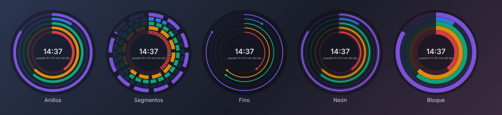

# Arco

[English](README.md)

Reloj de escritorio que muestra cuánto ha pasado del año, el mes, la semana, el día, la hora y el minuto. Queda siempre visible, con fondo transparente, y casi no consume recursos.



## Funciones

- Anillos para año, mes, semana, día (o tu jornada laboral), hora y minuto
- Avance en porcentaje o en unidades (18.5/24 h, 25/60 min, 20/60 s…)
- 8 estilos: anillos, segmentos, fino, neón, bloque, barras horizontales, barras verticales y analógico
- Un reloj por monitor, cada uno con su configuración
- Colores, transparencia y tamaño propios para cada estilo
- Hora y fecha con [formato personalizable](docs/format-codes.es.md)
- Sincronización de la configuración entre equipos con tu cuenta de Google o una carpeta sincronizada
- Español e inglés, ventana de ajustes en tema claro u oscuro
- Protección contra burn-in para pantallas OLED
- Inicio con Windows

## Descarga

Descarga el instalador desde [Releases](../../releases/latest). Funciona en Windows 10 y 11 y no necesita Python. Puedes instalarlo solo para ti (sin permisos de administrador) o para todos los usuarios del equipo.

Si el instalador no está firmado, Windows puede mostrar un aviso de SmartScreen: **Más información → Ejecutar de todas formas**. Ver [firma de código](docs/code-signing.es.md).

## Uso

| | |
|---|---|
| Mover | Arrastrar |
| Tamaño | Rueda del ratón |
| Opacidad | Mayús + rueda |
| Ajustes | Doble clic |
| Más opciones | Clic derecho |
| Mostrar u ocultar | Clic en el icono de la bandeja |
| Menú de la bandeja | Clic derecho en el icono de la bandeja |

Para añadir un reloj en otro monitor: clic derecho → **Nuevo reloj para otro monitor**.

Si activaste «dejar pasar los clics» y no puedes tocar el reloj: clic derecho en el icono de la bandeja → **Volver a recibir clics**.

## Sincronización

En **Ajustes → Sincronización** elige una de estas opciones:

- **Cuenta de Google**: Arco guarda la configuración en una carpeta oculta de tu Drive y no puede ver tus otros archivos.
- **Carpeta sincronizada**: cualquier carpeta de Google Drive para escritorio, OneDrive o Dropbox.

La posición de los relojes no se sincroniza, porque depende de los monitores de cada equipo.

## Desde el código

Requiere Python 3.10–3.14.

```bash
pip install -r requirements.txt
python arco.py
```

En Windows también puedes usar `iniciar.bat`, que crea el entorno virtual la primera vez. `build_installer.bat` genera el instalador (requiere [Inno Setup 6](https://jrsoftware.org/isinfo.php)).

Pruebas:

```bash
node tests/test_logic.js
python tests/test_sync.py
python arco.py --selftest
```

Para publicar una versión, cambia `__version__` en `arco.py` y publica un release en GitHub (o sube una etiqueta `v*`). GitHub Actions compila el instalador y lo adjunta. Para incluir el inicio de sesión con Google, consulta [docs/google-sync.es.md](docs/google-sync.es.md).

## Problemas frecuentes

- **El fondo se ve negro:** inicia con `--backend opengl`.
- **Errores al iniciar:** revisa `%LOCALAPPDATA%\Arco\arco.log` o usa `depurar.bat`.

## Licencia

MIT · [Privacidad](PRIVACY.md)
