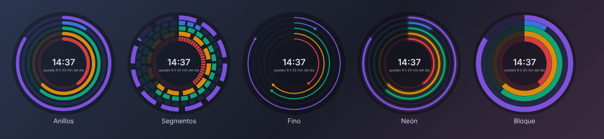

# Arco

[Español](README.es.md)

A desktop clock that shows how much of the year, month, week, day, hour and minute has passed. It stays on top with a transparent background and uses almost no resources.



## Features

- Rings for year, month, week, day (or your workday), hour and minute
- 8 styles: rings, segments, thin, neon, block, horizontal bars, vertical bars and analog
- One clock per monitor, each with its own settings
- Separate colors, opacity and size for each style
- Customizable [time and date format](docs/format-codes.md)
- Settings sync across devices with your Google account or a synced folder
- English and Spanish, light and dark settings window
- Burn-in protection for OLED screens
- Starts with Windows

## Download

Get the installer from [Releases](../../releases/latest). It runs on Windows 10 and 11 and needs neither Python nor administrator rights.

Windows may show a SmartScreen warning because the installer is not signed: **More info → Run anyway**.

## Usage

| | |
|---|---|
| Move | Drag |
| Size | Mouse wheel |
| Opacity | Shift + mouse wheel |
| Settings | Double-click |
| More options | Right-click |
| Show or hide | Click the tray icon |
| Tray menu | Right-click the tray icon |

To add a clock on another monitor: right-click → **New clock for another monitor**.

If you turned on click-through and can't reach the clock, right-click the tray icon → **Make clocks clickable again**.

## Sync

In **Settings → Sync**, choose one of:

- **Google account**: Arco stores its settings in a hidden folder in your Drive and can't see any of your other files.
- **Synced folder**: any Google Drive for desktop, OneDrive or Dropbox folder.

Clock positions are not synced, since they depend on each device's monitors.

## From source

Requires Python 3.10–3.14.

```bash
pip install -r requirements.txt
python arco.py
```

On Windows you can also run `iniciar.bat`, which sets up a virtual environment on first run. `build_installer.bat` builds the installer (requires [Inno Setup 6](https://jrsoftware.org/isinfo.php)).

Tests:

```bash
node tests/test_logic.js
python tests/test_sync.py
python arco.py --selftest
```

To publish a release, bump `__version__` in `arco.py` and publish a release on GitHub (or push a `v*` tag). GitHub Actions builds the installer and attaches it. To enable Google sign-in in the build, see [docs/google-sync.md](docs/google-sync.md).

## Troubleshooting

- **Black background instead of transparent:** start with `--backend opengl`.
- **Errors on startup:** check `%LOCALAPPDATA%\Arco\arco.log` or run `depurar.bat`.

## License

MIT · [Privacy](PRIVACY.md)
